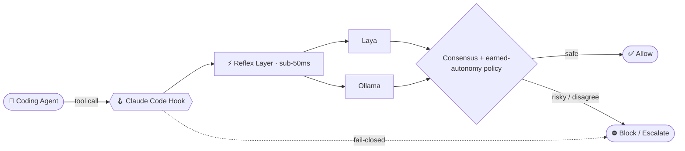

<div align="center">


[](https://git.io/typing-svg)

<p>
  <b>B.Tech Robotics & Artificial Intelligence</b> @ Amrita Vishwa Vidyapeetham, Chennai<br>
  <i>Pioneering autonomous agentic systems, sub-50ms reflex safety, and mission-critical intelligence.</i>
</p>

<a href="https://github.com/HirthikBalaji"></a>
<a href="https://github.com/HirthikBalaji?tab=followers"></a>
<a href="https://bughunters.google.com"></a>
<a href="https://www.rocketcenter.com"></a>

</div>

<br>

## 👨‍💻 About Me

```python
class HirthikBalaji:
    role      = "Robotics & AI Engineer"
    studying  = "B.Tech Robotics & AI @ Amrita Vishwa Vidyapeetham, Chennai"
    building  = ["ReflexArc", "AquiPulse", "AmritaGPT"]
    hunting   = "High-impact vulnerabilities in web, API & cloud infrastructure"
    trophies  = ["Google VRP bounty hunter", "NASA / U.S. Space & Rocket Center alum"]
    stack     = ["Python", "TypeScript", "C++", "PyTorch", "FastMCP", "FastAPI"]
    mission   = "Bridging autonomous agent architectures with cybersecurity precision."

    def say_hi(self):
        return "Let's build something remarkable. 🚀"
```

<br>

## 🏆 Hall of Fame

<table>
  <tr>
    <td align="center" width="33%" valign="top">
      <h3>🛡️</h3>
      <b>Google Bug Bounty Winner</b><br>
      <sub><b>$7,000 Awarded</b></sub><br><br>
      Discovered <b>two high-severity vulnerabilities</b> in core Google infrastructure, rewarded by Google's Vulnerability Reward Program.
    </td>
    <td align="center" width="33%" valign="top">
      <h3>🚀</h3>
      <b>NASA / U.S. Space & Rocket Center Alum</b><br>
      <sub><b>Huntsville, Alabama</b></sub><br><br>
      Selected for an intensive international program in astronautics, rocketry, mission leadership, and payload engineering.
    </td>
    <td align="center" width="33%" valign="top">
      <h3>🏛️</h3>
      <b>Institutional AI Architect</b><br>
      <sub><b>AmritaGPT & MCP Servers</b></sub><br><br>
      Built and deployed <b>AmritaGPT</b> and multiple <b>OpenAPI 3.1 MCP servers</b> automating academic workflows for thousands of students and faculty.
    </td>
  </tr>
</table>

<br>

## ⚡ What I'm Engineering Now

| | Project | Focus |
| :-: | :-- | :-- |
| 🛡️ | [**ReflexArc**](https://github.com/HirthikBalaji/reflexarc) | Sub-50ms "reflex layer" for autonomous AI coding agents: dual-engine System 1 consensus (**Laya** + **Ollama**) and fail-closed Claude Code hooks |
| 💧 | [**AquiPulse**](https://github.com/HirthikBalaji/AquiPulse) | Fleet-scale groundwater intelligence and aquifer depletion monitoring, derived from the electrical heartbeat of irrigation pumps |
| 🤖 | [**AmritaGPT**](https://github.com/HirthikBalaji/AmritaGPT-RAG-MCP) | Campus-wide institutional LLM infrastructure with custom **FastMCP** servers and production vector RAG pipelines |
| 🔐 | **Vulnerability Research** | Proactively hunting high-impact vulnerabilities in hyperscale web, API, and cloud infrastructure |

<br>

## 🚀 Featured Projects

### 🛡️ Flagship: [ReflexArc](https://github.com/HirthikBalaji/reflexarc)

> A sub-50ms System 1 reflex layer that sits between an autonomous coding agent and the actions it wants to take. Two independent engines vote, and if anything fails, the action is blocked.



<div align="center">

<a href="https://github.com/HirthikBalaji/reflexarc"></a>


</div>

<br>

<table>
  <tr>
    <td width="50%" valign="top">
      <b>⚡ <a href="https://github.com/HirthikBalaji/AquiPulse">AquiPulse</a></b><br>
      <sub>Fleet-scale groundwater monitoring that interprets electrical signal harmonics from agricultural pumps to estimate aquifer depth, with no downhole sensors.</sub><br><br>
      
      <code>Python</code> <code>Signal Processing</code> <code>Time-Series</code>
    </td>
    <td width="50%" valign="top">
      <b>🤖 <a href="https://github.com/HirthikBalaji/AmritaGPT-RAG-MCP">AmritaGPT-RAG-MCP</a></b><br>
      <sub>Production RAG MCP server, institutional intelligence infrastructure, and OpenAPI gateway for campus AI agents.</sub><br><br>
      
      <code>Python</code> <code>FastMCP</code> <code>Vector DB</code> <code>OpenAPI</code>
    </td>
  </tr>
  <tr>
    <td width="50%" valign="top">
      <b>📊 <a href="https://github.com/HirthikBalaji/LinkedIn_Instagram">LinkedIn_Instagram</a></b><br>
      <sub>Institutional social media intelligence and FastMCP server for cross-platform analytics and automated brand insights.</sub><br><br>
      
      <code>Python</code> <code>FastMCP</code> <code>REST APIs</code>
    </td>
    <td width="50%" valign="top">
      <b>📅 <a href="https://github.com/HirthikBalaji/AVV-Chennai-Academic-Calendar-MCP">AVV Academic Calendar MCP</a></b><br>
      <sub>OpenAPI 3.1 compatible academic calendar MCP server for automated schedule retrieval and campus workflow orchestration.</sub><br><br>
      
      <code>Python</code> <code>FastAPI</code> <code>OpenAPI 3.1</code>
    </td>
  </tr>
  <tr>
    <td colspan="2" valign="top">
      <b>🩺 <a href="https://github.com/HirthikBalaji/EdgeAI-HealthCare">EdgeAI-HealthCare</a></b><br>
      <sub>Ultra-low-latency edge computing and sensor intelligence for real-time biomedical diagnostics.</sub><br><br>
      
      <code>C</code> <code>Embedded C</code> <code>Edge AI</code>
    </td>
  </tr>
</table>

<br>

## 🛠️ Technical Arsenal

<div align="center">

**🧠 AI, Agentic & Decision Systems**


<br><br>

**🛡️ Cybersecurity & Vulnerability Research**


<br><br>

**💻 Languages & Core Systems**


<br>

**🌐 Web & Full-Stack Engineering**


<br>

**⚙️ DevOps, Cloud & Infrastructure**


</div>

<br>

## 📈 GitHub Metrics & Activity

<div align="center">


</div>

<br>

## 💬 Ask Me About

<div align="center">

| 🛡️ Agent safety & guardrails | 🔌 MCP servers & OpenAPI gateways | 🧠 Production RAG & LLM orchestration |
| :-: | :-: | :-: |
| **🔐 Web, API & cloud vulnerability research** | **🤖 Robotics & edge AI** | **🚀 Space & rocketry programs** |

</div>

<br>

<div align="center">

### 🤝 Let's Connect & Collaborate

<a href="https://www.linkedin.com/in/hirthik-balaji-c-519b77229/"></a>
<a href="mailto:hirthikbalaji2006@gmail.com"></a>
<a href="https://github.com/HirthikBalaji"></a>

<br><br>

*"Bridging autonomous agent architectures with cybersecurity precision."*


</div>
